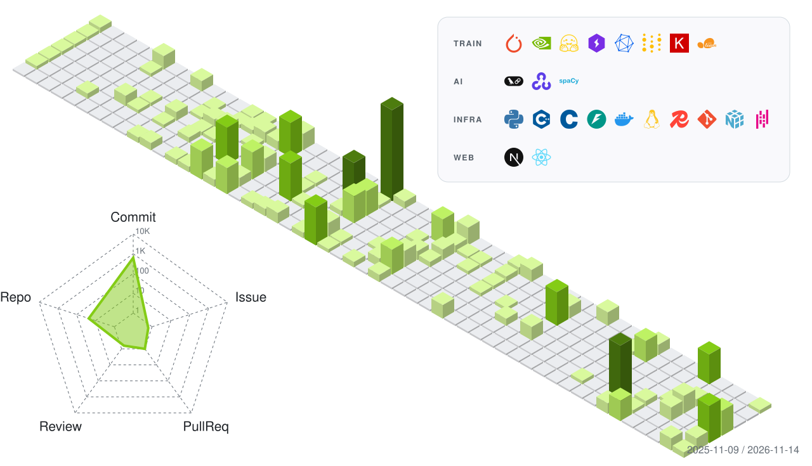

  <picture>
    <source media="(prefers-color-scheme: dark)" srcset="https://readme-typing-svg.demolab.com?font=Righteous&size=35&pause=1000&color=EDFF37&center=true&vCenter=true&width=438&height=52&lines=Hello+there!;I'm+Firoj." />
    
  </picture>

 

<table align="center" style="border: none; background: transparent;">
  <tr style="border: none; background: transparent;">
    <td align="center" valign="middle" style="border: none; padding-right: 24px;">
      
    </td>
    <td align="center" valign="middle" style="border: none;">
      <picture>
        <source media="(prefers-color-scheme: dark)" srcset="https://github-readme-streak-stats-sigma-two.vercel.app?user=Firojpaudel&theme=merko&hide_border=true&card_height=175&exclude_days=Sat" />
        
      </picture>
    </td>
  </tr>
</table>

 

  <picture>
    <source media="(prefers-color-scheme: dark)" srcset="./profile-3d-contrib/firoj-dark.svg" />
    
  </picture>

 

<table align="center" style="border: none; background: transparent;">
  <tr style="border: none; background: transparent;">
    <td align="center" valign="middle" style="border: none; padding-right: 32px;">
      <picture>
        <source media="(prefers-color-scheme: dark)" srcset="./assets/connect/connect-label.svg" />
        
      </picture>
    </td>
    <td align="center" valign="middle" style="border: none; border-left: 1px dashed #30363d; padding-left: 32px;">
      

        &nbsp;&nbsp;
        &nbsp;&nbsp;
        &nbsp;&nbsp;
        
      

      

        &nbsp;&nbsp;
        &nbsp;&nbsp;
        &nbsp;&nbsp;
        &nbsp;&nbsp;
        
      

    </td>
  </tr>
</table>
